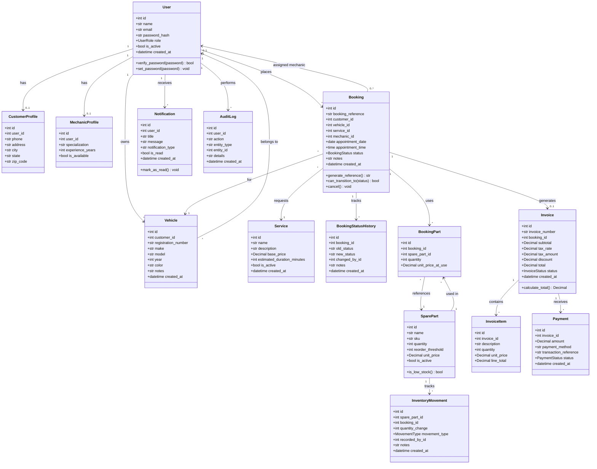
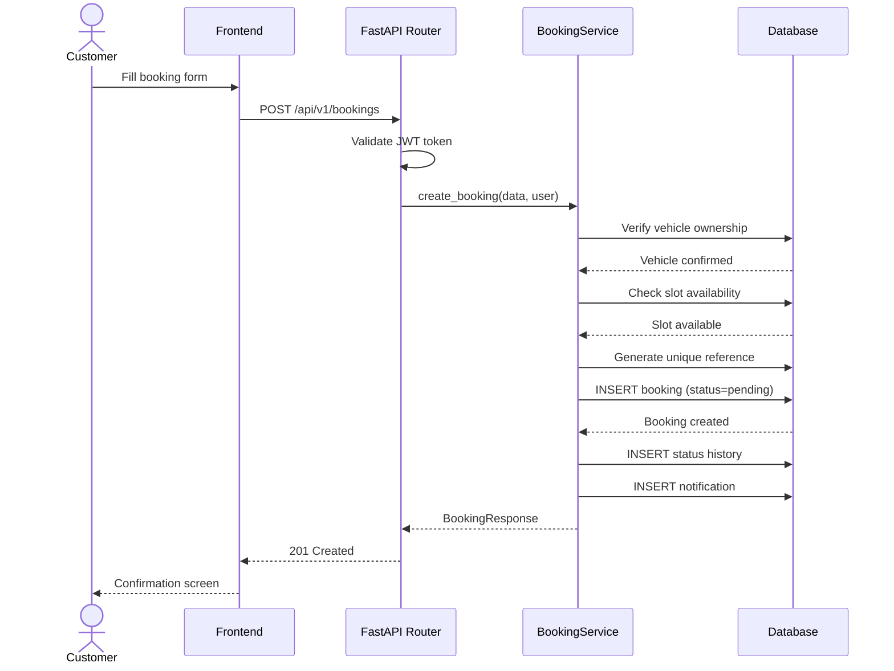
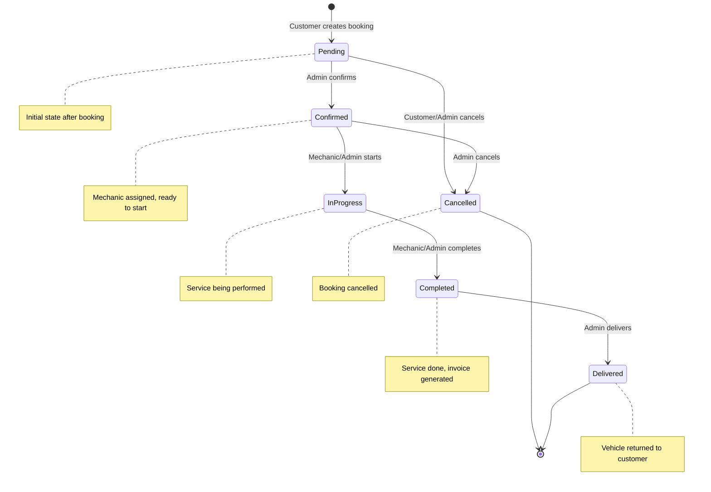
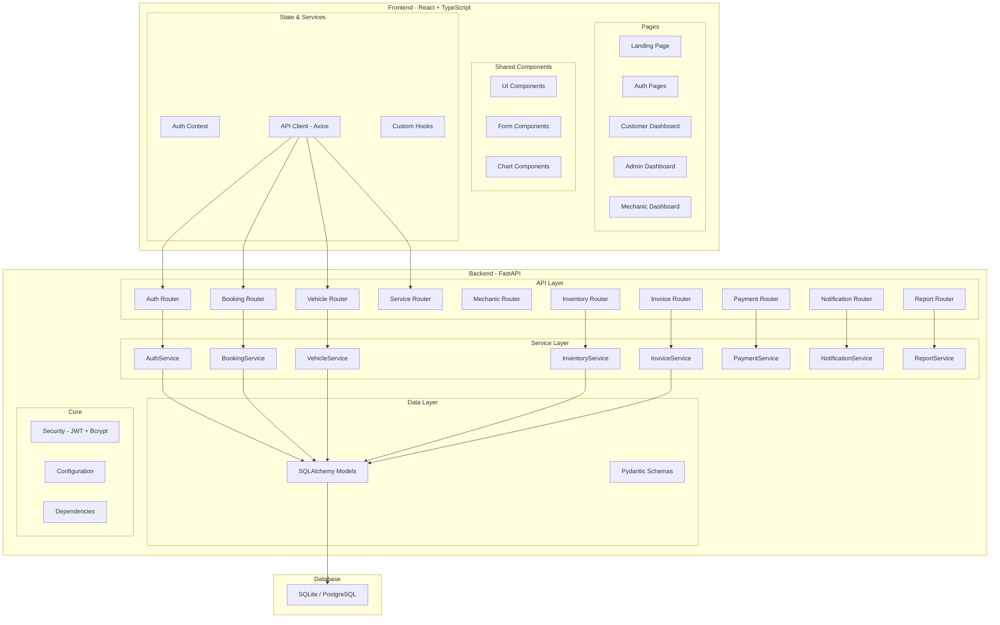
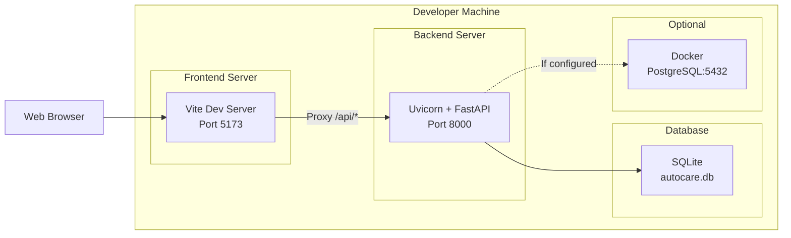

# AutoCare — UML Diagrams

## 1. Use Case Diagram

```mermaid
graph TD
    subgraph "AutoCare System"
        UC1["Register Account"]
        UC2["Login / Logout"]
        UC3["Manage Profile"]
        UC4["Manage Vehicles"]
        UC5["Browse Services"]
        UC6["Book Appointment"]
        UC7["View Bookings"]
        UC8["Cancel Booking"]
        UC9["View Invoice"]
        UC10["Make Payment"]
        UC11["View Notifications"]
        UC12["Confirm Booking"]
        UC13["Assign Mechanic"]
        UC14["Manage Services"]
        UC15["Manage Mechanics"]
        UC16["Manage Inventory"]
        UC17["Generate Invoice"]
        UC18["View Reports"]
        UC19["View Dashboard"]
        UC20["Update Job Status"]
        UC21["Record Parts Used"]
        UC22["View Assigned Jobs"]
        UC23["Mark Job Complete"]
        UC24["Manage Customers"]
    end

    Customer["🧑 Customer"]
    Admin["👔 Admin"]
    Mechanic["🔧 Mechanic"]

    Customer --- UC1
    Customer --- UC2
    Customer --- UC3
    Customer --- UC4
    Customer --- UC5
    Customer --- UC6
    Customer --- UC7
    Customer --- UC8
    Customer --- UC9
    Customer --- UC10
    Customer --- UC11

    Admin --- UC2
    Admin --- UC12
    Admin --- UC13
    Admin --- UC14
    Admin --- UC15
    Admin --- UC16
    Admin --- UC17
    Admin --- UC18
    Admin --- UC19
    Admin --- UC24
    Admin --- UC11

    Mechanic --- UC2
    Mechanic --- UC20
    Mechanic --- UC21
    Mechanic --- UC22
    Mechanic --- UC23
    Mechanic --- UC11
```

## 2. Class Diagram

## 3. Sequence Diagram — Booking Flow

## 4. Activity Diagram — Service Completion & Billing

```mermaid
flowchart TD
    A["Service Completed by Mechanic"] --> B["Mechanic updates status to 'Completed'"]
    B --> C["System records status history"]
    C --> D["Admin reviews completed service"]
    D --> E{"Generate Invoice?"}

    E -- Yes --> F["System calculates invoice"]
    F --> G["Fetch service base price"]
    G --> H["Fetch consumed spare parts"]
    H --> I["Apply tax rate 18%"]
    I --> J["Apply discount if any"]
    J --> K["Calculate final total"]
    K --> L["Create invoice with line items"]
    L --> M["Notify customer of invoice"]
    M --> N["Customer views invoice"]

    E -- No --> D

    N --> O{"Customer pays?"}
    O -- Yes --> P["Customer initiates demo payment"]
    P --> Q["Server validates payment amount"]
    Q --> R["Process demo transaction"]
    R --> S["Record payment with reference"]
    S --> T["Update invoice status to 'Paid'"]
    T --> U["Notify customer of payment"]
    U --> V["Admin marks as 'Delivered'"]
    V --> W["Service complete"]

    O -- Not yet --> N
```

## 5. State Diagram — Booking Status

## 6. Component Diagram

## 7. Deployment Diagram

